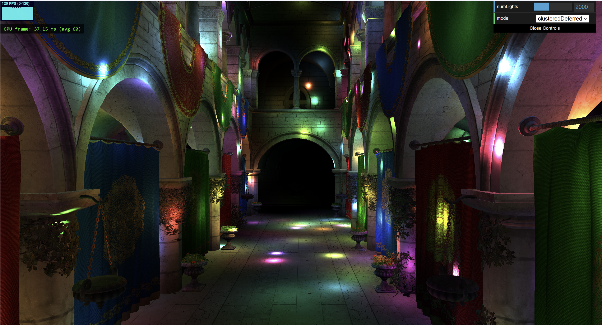
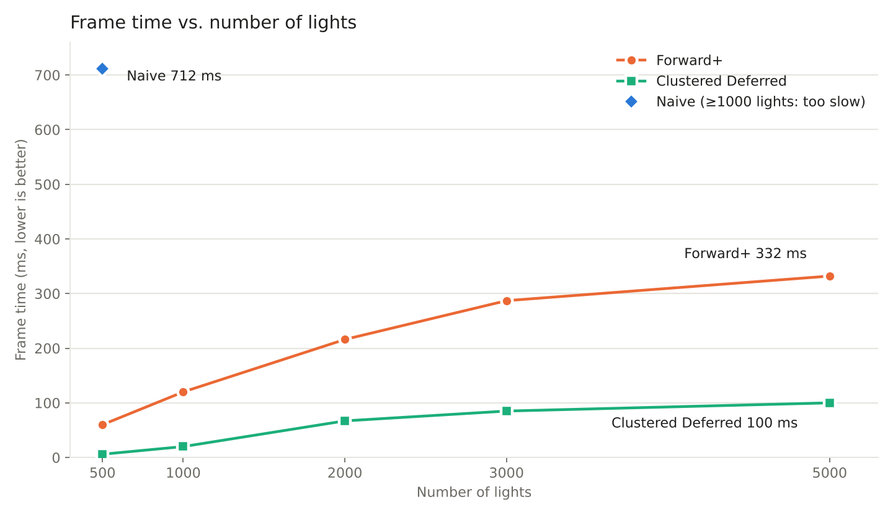
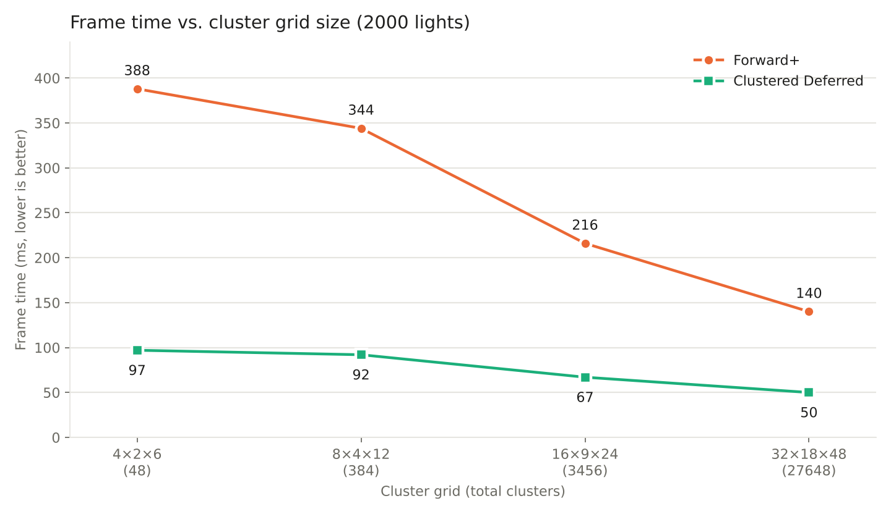
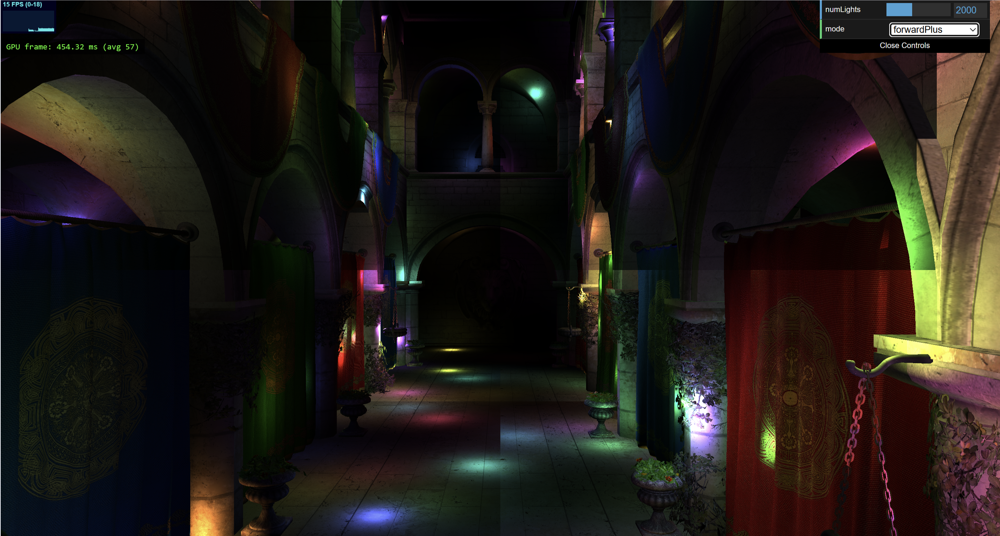

WebGPU Forward+ and Clustered Deferred Shading
======================

**University of Pennsylvania, CIS 5650: GPU Programming and Architecture, Project 4**

* Shanshan Wu
* Tested on: **Google Chrome 155.0.8059.80 (Official Build) (64-bit)** on
 Windows 11, AMD Ryzen 9 270 @ ~4.0GHz, 32GB RAM, NVIDIA GeForce RTX 5070 Laptop GPU (personal laptop)

### Live Demo

[Demo](https://popi-x.github.io/Project4-WebGPU-Forward-Plus-and-Clustered-Deferred)

---

## Overview

This project renders the Sponza atrium lit by up to 5000 moving point lights in WebGPU, using three renderers that can be switched in the GUI:

| Renderer | Passes per frame | Lights evaluated per fragment |
|---|---|---|
| **Naive** | 1 render pass | all lights |
| **Forward+** | clustering compute + 1 render pass | only the lights in the fragment's cluster |
| **Clustered Deferred** | clustering compute + G-buffer pass + fullscreen lighting pass | only the lights in the pixel's cluster, once per pixel |

---

## Features

### 1. Light Clustering (shared by Forward+ and Clustered Deferred)

The view frustum is divided into a **32 × 18 × 48** grid of clusters (27648 clusters). A compute shader (`clustering.cs.wgsl`, one thread per cluster) builds each cluster's light list every frame.

- **XY**: the screen is split evenly into 32 × 18 tiles in NDC.
- **Z**: depth is sliced **logarithmically** between near and far:
  `zNear_k = near · (far / near)^(k / Z)`. 
- **Cluster bounds**: the 4 NDC corners of each tile are un-projected with `invProjMat` and scaled to the slice's near/far depth, giving 8 view-space points. Their min/max is the cluster's **AABB**.
- **Light assignment**: each light's position is transformed to view space and tested against the AABB with a **sphere–AABB test** (clamp the center into the box, compare squared distance with r²). Up to **256** light indices are stored per cluster.

### 2. Forward+

The scene is drawn once. In the fragment shader, each fragment:
1. finds its cluster: x, y from `@builtin(position)` (pixel coordinates, y flipped to match NDC), z from the view-space depth with the inverse of the log slicing formula;
2. loops only over that cluster's lights.

### 3. Clustered Deferred

1. **G-buffer pass**: draws the scene and writes, per pixel, the closest surface's data into 3 render targets. No lighting is done here.

   | Target | Content | Format |
   |---|---|---|
   | `@location(0)` | world position | `rgba16float` |
   | `@location(1)` | normal | `rgba16float` |
   | `@location(2)` | albedo | `rgba8unorm` |

2. **Fullscreen pass**: one screen-covering triangle (generated from `@builtin(vertex_index)`, no vertex buffer). Each pixel reads the G-buffer with `textureLoad`, finds its cluster, and shades with the cluster's lights. Every pixel is shaded exactly once.

---

## Performance Analysis

**Setup:** Canvas resolution 2878 × 1556. Cluster grid 16 × 9 × 24 for all results except the grid size test and the optimization section, at most 256 lights per cluster, light radius 2, camera at the default position. Frame time is measured on the GPU side: the time from just before `draw()` until `device.queue.onSubmittedWorkDone()` resolves, averaged over 60 frames. This measurement is not limited by vsync.

### Frame time vs. number of lights

| Lights | Naive (ms) | Forward+ (ms) | Clustered Deferred (ms) |
|---:|---:|---:|---:|
| 500 | 712 | 60 | 6 |
| 1000 | too slow | 120 | 20 |
| 2000 | / | 216 | 67 |
| 3000 | / | 287 | 85 |
| 5000 | / | 332 | 100 |

### Is one of them faster?

Clustered Deferred is the fastest at every light count. At 500 lights it takes 6 ms, about 10× faster than Forward+ at 60 ms and over 100× faster than Naive at 712 ms. At 5000 lights Clustered Deferred takes 100 ms while Forward+ takes 332 ms, about 3.3× slower.

Clustered Deferred also adds far less time per light. From 500 to 5000 lights its frame time increases by 94 ms, while Forward+ increases by 272 ms. 

### Why?

**Naive vs. clustered.** Naive loops over every light for every fragment, so its cost grows with fragments times lights. Clustering limits each fragment to the lights that can actually reach it. With a light radius of 2, most clusters only overlap a small fraction of the scene's lights.

**Forward+ vs. Clustered Deferred.** Sponza has a lot of overdraw: columns, arches and curtains overlap on screen. Forward+ runs the full lighting loop for every fragment that passes the depth test at the moment it is drawn, including fragments that a closer surface covers later. The fragment shader also uses `discard` for alpha testing, which prevents the GPU from rejecting hidden fragments before shading. Clustered Deferred only writes position, normal and albedo in the geometry pass, which is cheap. The lighting loop then runs once per pixel in the fullscreen pass. Since lighting dominates the cost, the work saved grows with the number of lights.

### Frame time vs. cluster grid size

All runs use 2000 lights at the same resolution and camera position. Only `clusterX`, `clusterY` and `clusterZ` in `shaders.ts` change.

| Grid | Clusters | Forward+ (ms) | Clustered Deferred (ms) |
|---|---:|---:|---:|
| 4 × 2 × 6 | 48 | 388 | 97 |
| 8 × 4 × 12 | 384 | 344 | 92 |
| 16 × 9 × 24 | 3456 | 216 | 67 |
| 32 × 18 × 48 | 27648 | 140 | 50 |

Within this range, a finer grid is always faster. Going from 48 to 27648 clusters cuts Forward+ from 388 ms to 140 ms and Clustered Deferred from 97 ms to 50 ms.

**Why finer is faster.** Smaller clusters overlap fewer lights, so each fragment loops over a shorter list. Lighting runs once per shaded fragment, which is millions of times per frame at this resolution. The clustering pass runs once per cluster. Even at 27648 clusters it does far less work than the lighting loop it saves.

**Forward+ benefits more.** Forward+ drops 2.8× while Clustered Deferred drops 1.9×. Forward+ runs the lighting loop for every overlapping fragment, so a shorter light list saves time several times per pixel. Clustered Deferred saves it only once per pixel.

**Coarse grids also look wrong** The image below shows visible tile edges with a coarse grid and 2000 lights. They come from the 256-light cap.

**Cost of a finer grid.** The cluster buffer stores 257 integers per cluster. At 32 × 18 × 48 that is about 28 MB, compared with about 3.5 MB at 16 × 9 × 24. A finer grid also means more compute threads, so the gain will flatten once the lighting work is no longer the bottleneck.

### Best and worst cases for clustering

The best case is many small lights spread across a deep scene. Each cluster then overlaps only a few lights and most of the lighting work is skipped. The worst case is a few lights with a large radius, or lights packed into one spot. Most clusters then overlap most of the lights, so the shading cost is close to Naive while the clustering pass still adds its own cost. Packed lights can also exceed the 256 cap and drop lights.

### Benefits and tradeoffs

| | Forward+ | Clustered Deferred |
|---|---|---|
| Many lights, lots of overdraw | Shades hidden fragments, slows down quickly | Shades each pixel once, scales well |
| Few lights, simple scenes | Little overdraw to waste, one fewer pass | G-buffer cost may outweigh the savings |
| Memory and bandwidth | Only a depth buffer | Three extra screen-sized targets per frame |
| Transparency | Works naturally, surfaces are shaded in draw order | G-buffer holds one surface per pixel, transparent objects need a separate forward pass |
| MSAA | Works with standard hardware MSAA | Needs multisampled G-buffer targets, which multiplies memory |
| Material flexibility | Each material can run its own shading code | Limited to the data stored in the G-buffer |

In short, Forward+ is the better fit for scenes with transparency, MSAA or varied materials, or when memory is tight. Clustered Deferred is the better fit for opaque scenes with many lights and heavy overdraw, like Sponza.

### Optimizations

**Finer cluster grid.** Based on the grid size test above, I changed the default grid from 16 × 9 × 24 to 32 × 18 × 48. Measured with 2000 lights:

| Renderer | Before, 16 × 9 × 24 (ms) | After, 32 × 18 × 48 (ms) | Speedup |
|---|---:|---:|---:|
| Forward+ | 216 | 140 | 1.5× |
| Clustered Deferred | 67 | 50 | 1.3× |

The tradeoff is memory. The cluster buffer grows from about 3.5 MB to about 28 MB.

### Possible further optimizations

- **Smaller G-buffer.** Reconstruct world position from the depth buffer and `invProjMat` instead of storing it. Encode the normal into two components with octahedral encoding and pack everything into a single `rgba32uint` target. This cuts bandwidth in the fullscreen pass.
- **Compute-shader lighting pass.** Replace the fullscreen triangle with a compute pass that reads the G-buffer and writes the output directly.
- **Faster clustering.** Use shared memory to load lights in batches per workgroup, or cull lights per depth slice first and then per tile.
- **Avoid wasted shading in Forward+.** Add a depth prepass so the main pass only shades visible fragments.

---

### Credits

- [Vite](https://vitejs.dev/)
- [loaders.gl](https://loaders.gl/)
- [dat.GUI](https://github.com/dataarts/dat.gui)
- [stats.js](https://github.com/mrdoob/stats.js)
- [wgpu-matrix](https://github.com/greggman/wgpu-matrix)
